<h1 align="center">
	  
	Setotower Downloader
</h1>

	English
	&nbsp;&nbsp;| &nbsp;&nbsp;
	<a href="https://github.com/aezammi/setotower-downloader-android/blob/main/docs/README-sq.md">Shqip</a>
	&nbsp;&nbsp;| &nbsp;&nbsp;
	<a href="https://github.com/aezammi/setotower-downloader-android/blob/main/docs/README-az.md">Azərbaycanca</a>
	&nbsp;&nbsp;| &nbsp;&nbsp;
	<a href="https://github.com/aezammi/setotower-downloader-android/blob/main/docs/README-tr.md">Türkçe</a>
	&nbsp;&nbsp;| &nbsp;&nbsp;
	<a href="https://github.com/aezammi/setotower-downloader-android/blob/main/docs/README-id.md">Indonesia</a>
	&nbsp;&nbsp;| &nbsp;&nbsp;
	<a href="https://github.com/aezammi/setotower-downloader-android/blob/main/docs/README-pt.md">Português</a>
	&nbsp;&nbsp;| &nbsp;&nbsp;
	<a href="https://github.com/aezammi/setotower-downloader-android/blob/main/docs/README-es.md">Español</a>
	&nbsp;&nbsp;| &nbsp;&nbsp;
	<a href="https://github.com/aezammi/setotower-downloader-android/blob/main/docs/README-ja.md">Japanese</a>
	&nbsp;&nbsp;| &nbsp;&nbsp;
	<a href="https://github.com/aezammi/setotower-downloader-android/blob/main/docs/README-zh_CN.md">简体中文</a>
	&nbsp;&nbsp;| &nbsp;&nbsp;
	<a href="https://github.com/aezammi/setotower-downloader-android/blob/main/docs/README-ro.md">Română</a>
	&nbsp;&nbsp;| &nbsp;&nbsp;
	<a href="https://github.com/aezammi/setotower-downloader-android/blob/main/docs/README-ar.md">العربية</a>
	&nbsp;&nbsp;| &nbsp;&nbsp;
	<a href="https://github.com/aezammi/setotower-downloader-android/blob/main/docs/README-ru.md">Русский</a>

<h3 align="center">
	Setotower Downloader is the Setotower Android client for downloading authorized media directly to the device.
</h3>
<h4 align="center">
	The Setotower Android client for downloading authorized media directly to the device. It includes GPLv3-licensed third-party components; see the bundled notices.
</h4>

### Only the links above are the only trusted sources of Setotower Downloader. Everything else is not related to me.

## 💡 Features

### ⬇️ Downloading
- Download audio or video from supported sites through the Setotower download engine
- Share a link to the app and download straight from the bottom card, no need to open the app
- Quick download mode to start instantly without waiting for data to load
- Playlists and bulk downloads: edit every item separately or bulk edit type, format, path and filename template for all of them, sort by author, duration, title or date
- Feed a `.txt` file of links, playlists or search queries and the app processes them all
- Queue, schedule by date and time, and run multiple downloads at the same time
- Pause / resume, re-download failed or cancelled items with swipe gestures
- Observe sources: watch playlists and channels and automatically download new uploads, with optional sync
- Duplicate checking, failed data fetches are saved so you can retry them later
- Uploads to cloud providers (e.g. Nextcloud) when your download path is an external storage provider
- Android 16 live notifications for every running download

### ✂️ Editing your files
- Cut videos by timestamps or chapters with unlimited cuts, and optionally merge the cuts into one file
- Crop videos right from the download card
- Split items into separate files by chapters
- Remove or mark SponsorBlock segments as chapters
- Embed subtitles, metadata, chapters and thumbnails, or edit the title and author
- Burn subtitles into the video
- Search synced or plain lyrics from [lrclib.net](https://lrclib.net), preview and adjust their timing, then embed them or save them as `.lrc`
- Compatible mode to re-encode into widely supported formats
- Filename templates with live preview, or simple subfolders by playlist, website or download type

### 🔗 Integrations
- Share a URL to Setotower Downloader from another app
- Use Android intents for supported download actions
- Choose format, quality, filename and destination before starting a download

### 🎨 App
- Material You design with theming options and a customizable bottom navigation
- Incognito mode so no history or logs are saved
- Download logs, search history and a detailed download history with different card layouts
- Backup and restore almost everything, right from the welcome screen too
- Files manager to clear caches and leftovers

## 🧩 Plugin Support

Setotower Downloader orchestrates plugins so users can freely upgrade and downgrade components such as:
- Python
- JS Runtimes (NodeJS, Deno)
- FFmpeg
- Aria2c

You can install Setotower Downloader packages from this repository [Setotower Downloader-packages](https://github.com/aezammi/setotower-downloader-android-packages/) or through the updating section in the application.
 For more information refer to the repo's README.

## 📲 Screenshots

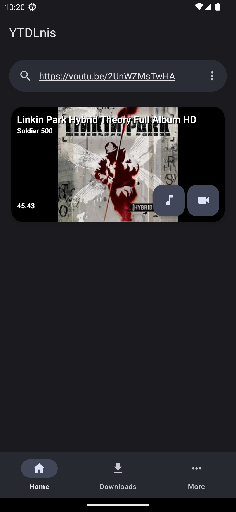
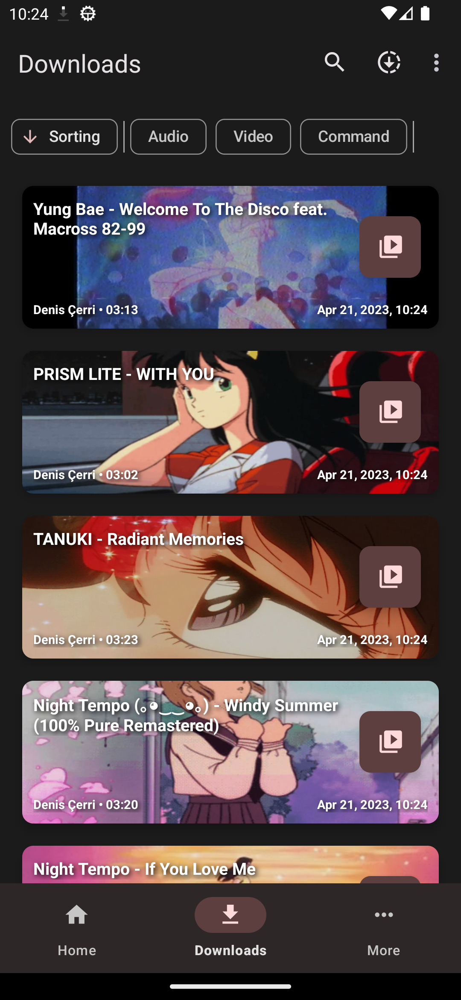
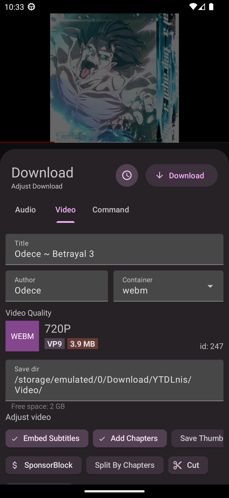
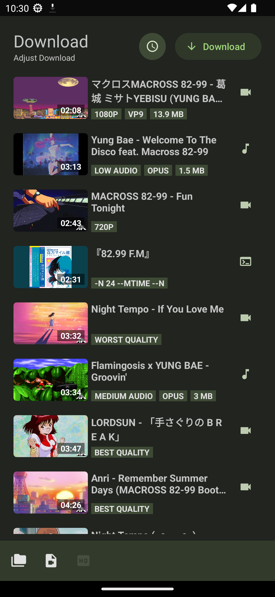
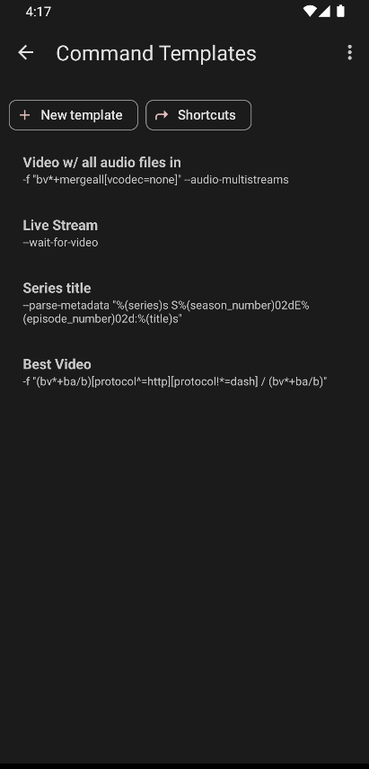
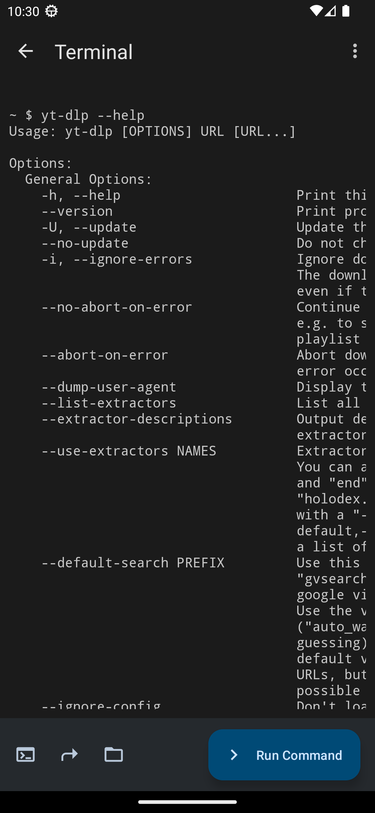
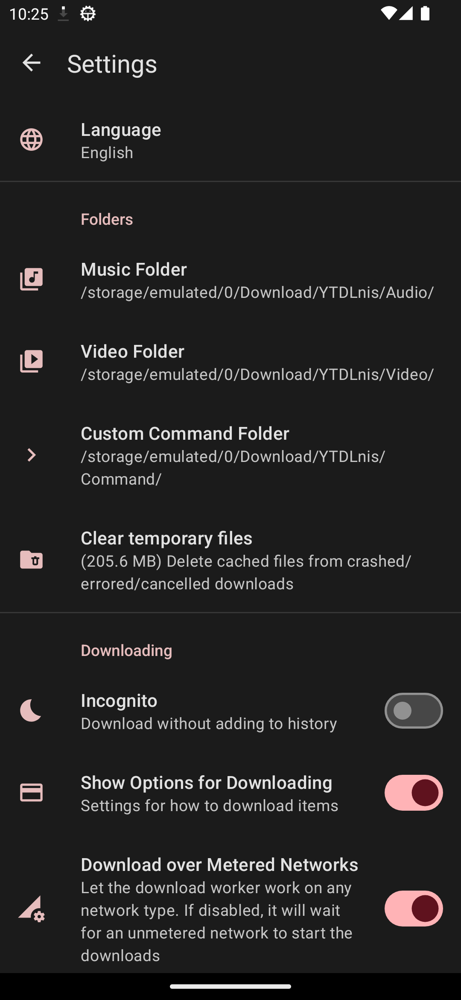
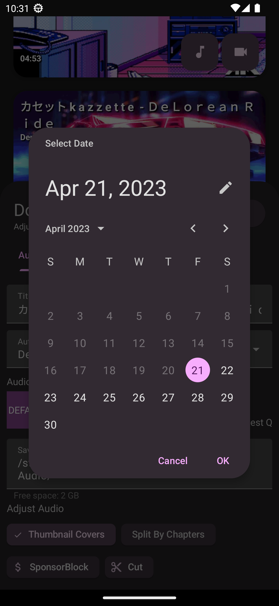
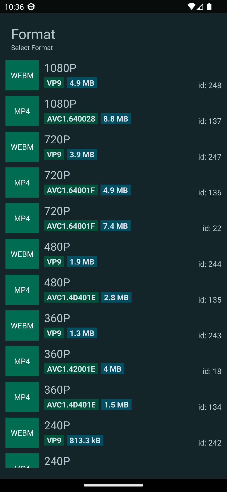
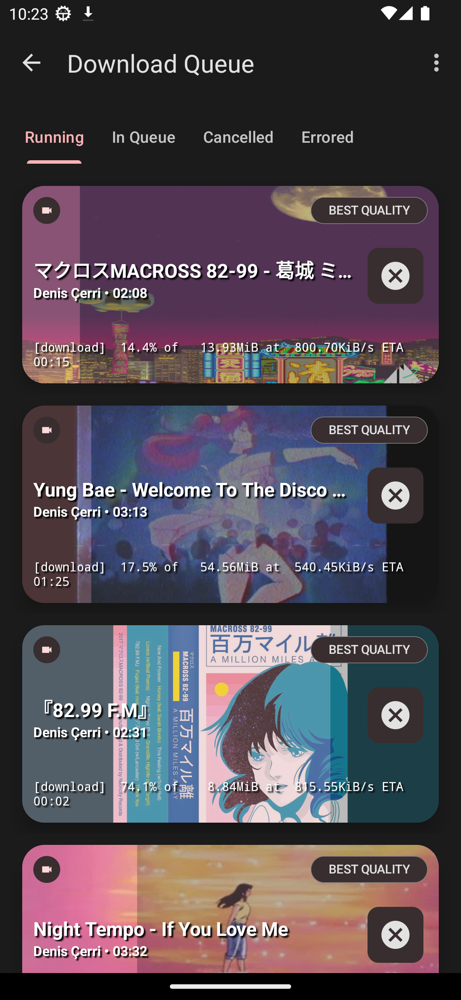
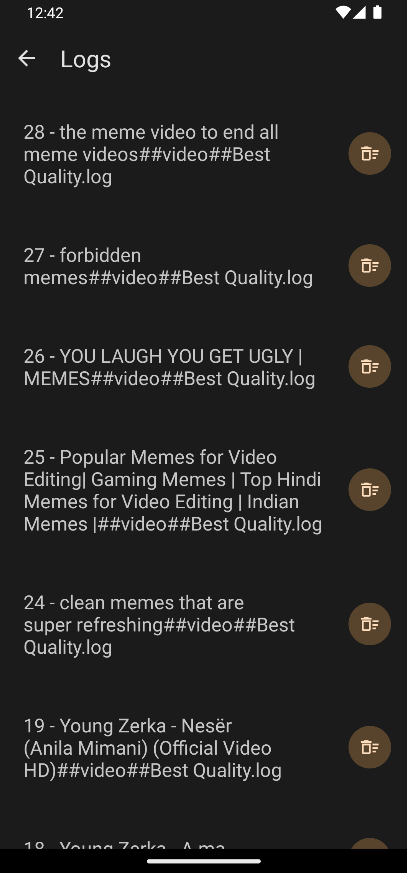
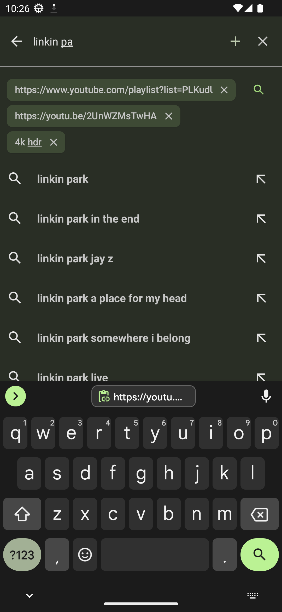
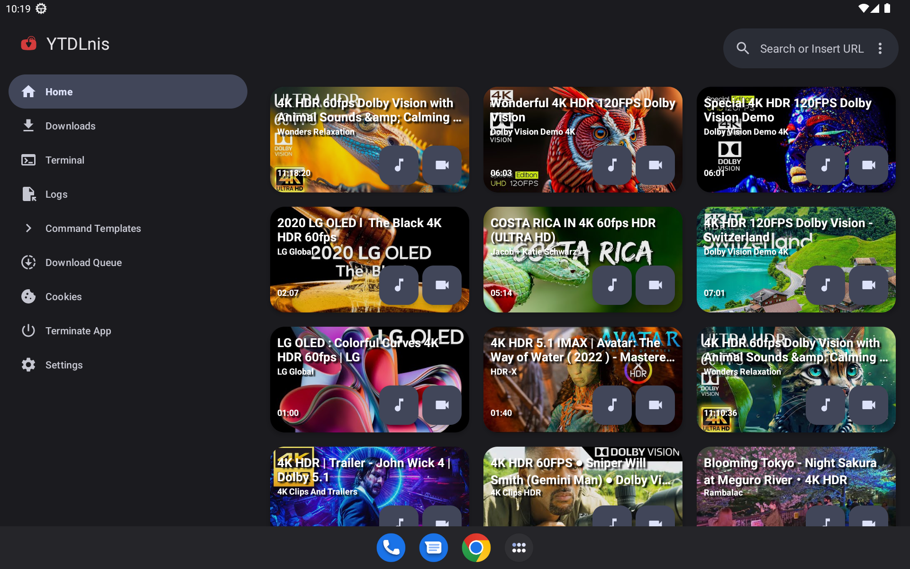

## 💬 Contact

Use the [GitHub repository](https://github.com/aezammi/setotower-downloader-android) for releases, issues, and project discussion.

## 😇 Contributing

Please read the [contributing](CONTRIBUTING.MD) section if you would like to contribute.

## 🔑 Connect with third-party apps using the package name

The app's package name is "com.setotower.downloader".

## 🔍 Verify application integrity

Release APK checksums are published with each GitHub release. Verify the checksum before installing an APK obtained from another source.

## 🤖 Connect with third-party apps using intents

You can use intents to push commands to the app to run downloads without user interaction.
Accepted variables:

<b>TYPE</b> -> it can be: audio,video,command  
<b>BACKGROUND</b> -> it can be: true,false. If its true the app won't show the download card no matter what and run the download in the background  

### An example of downloading an audio item in the background with Tasker
1. Create Send Intent task
2. Action: android.intent.action.SEND
3. Cat: Default
4. Mime Type: text/*
5. Extra: android.intent.extra.TEXT:url (instead of "url" write the URL of the video you want to download)
6. Extra: TYPE:audio
7. Extra: BACKGROUND:true

## 📄 License

[GNU GPL v3.0](https://github.com/aezammi/setotower-downloader-android/blob/main/LICENSE)

Except for the source code licensed under the GPLv3 license, all other parties are prohibited from using the "Setotower Downloader" name as a downloader app, and the same is true for its derivatives. Derivatives include but are not limited to forks and unofficial builds.

## 🙏 Thanks

- [decipher3114](https://github.com/decipher3114) for the app's icon
- [dvd](https://github.com/yausername/dvd) for being an example youtubedl-android implementation
- [seal](https://github.com/JunkFood02/Seal) for certain design elements and features I wanted to have in this app when I started developing it
- [youtubedl-android](https://github.com/yausername/youtubedl-android) for porting yt-dlp to Android
- [yt-dlp](https://github.com/yt-dlp/yt-dlp) and its contributors for making this tool possible. Without it this app wouldn't exist

and to a lot of other people, such as contributors.
