<h1 align="center">
	  
	Setotower Downloader
</h1>

	<a href="https://github.com/aezammi/setotower-downloader-android/blob/main/README.md">English</a>
	&nbsp;&nbsp;| &nbsp;&nbsp;
	Indonesia

<h3 align="center">
	Setotower Downloader adalah pengunduh video/audio sumber terbuka dan gratis yang menggunakan yt-dlp bagi Android 7.0 ke atas.
</h3>

## 💡 Fitur:

- unduh berkas audio/video dari lebih dari <a href="https://github.com/yt-dlp/yt-dlp/blob/master/supportedsites.md">1000 situs web</a>
- memproses daftar putar
	- sunting setiap butir daftar putar secara terpisah persis seperti pada butir unduhan normal.
	- pilih format umum untuk semua butir dan/atau pilih beberapa format audio jikalau saja kamu mengunduhnya sebagai sebuah video
	- pilih jalur pengunduhan bagi semua butir
	- pilih templat nama berkas bagi semua butir
	- mutakhirkan jenis unduhan secara berkelompok menjadi audio/video/perintah kustom dalam sekali klik
- antrekan unduhan dan jadwalkan berdasarkan tanggal dan waktu
	- kamu juga bisa menjadwalkan beberapa butir sekaligus
- unduh beberapa butir sekaligus
	- kamu bisa mencadangkan dan memulihkan templat, sehingga kamu bisa membagikannya dengan teman-temanmu
- potong video berdasarkan stempel waktu dan babak video (Fitur yt-dlp ini bersifat eksperimental pada proyek orisinalnya)
	- kamu bisa melakukan pemotongan sebanyak yang kamu inginkan (tanpa batas jumlah)
- hilangkan elemen sponsorblock dari butirnya
	- (atau) tanamkan sebagai babak-babak dalam videomu
- menanamkan takarir (subtitle)/metadata/babak, dll.
- memodifikasi metadata seperti judul dan penggubah
- pisahkan butir menjadi berkas-berkas terpisah tergantung pada babaknya
- pilih format unduhan yang berbeda
- kartu bagian bawah langsung dari menu berbagi, tidak perlu membuka aplikasi
	- kamu bisa membuat berkas txt dan mengisinya dengan pranala/daftar putar/kueri penelusuran yang dipisahkan dengan baris baru dan aplikasi akan memprosesnya
- telusuri atau sisipkan pranala dari aplikasi
	- kamu bisa menumpuk penelusurannya sehingga kamu bisa memprosesnya sekaligus
- merekam-catat (log) unduhan jikalau saja terjadi masalah
- mengunduh ulang unduhan yang dibatalkan atau gagal
	- kamu bisa menggunakan gestur untuk menggeser ke kiri untuk mengunduh ulang dan ke kanan untuk menghapus
	- kamu bisa menge-klik lama tombol unduh ulang di lembar rincian untuk memperlihatkan kartu unduhan untuk fungsionalitas selengkapnya
- mode penyamaran ketika kamu tidak ingin menyimpan riwayat unduhan atau rekam-catat (log)
- mode unduhan lekas
	- segera unduh tanpa harus menunggu data diproses. Nonaktifkan kartu bagian bawah dan ia akan langsung dimulai
- buka / bagikan berkas unduhan langsung dari notifikasi yang selesai
- sebagian besar fitur yt-dlp diimplementasi, saran-saran dipersilakan
- Antarmuka Material You
- Opsi tema
- Fitur pencadangan dan pemulihan. (Hampir semuanya bisa dicadangkan)
- Arsitektur MVVM dengan WorkManager

## 📲 Tangkapan Layar

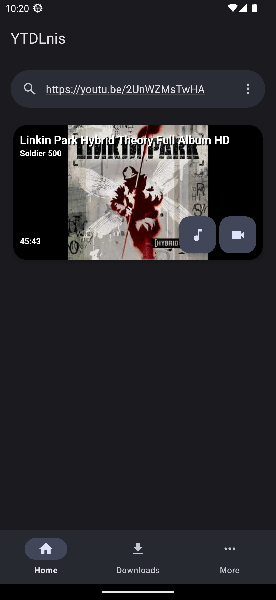
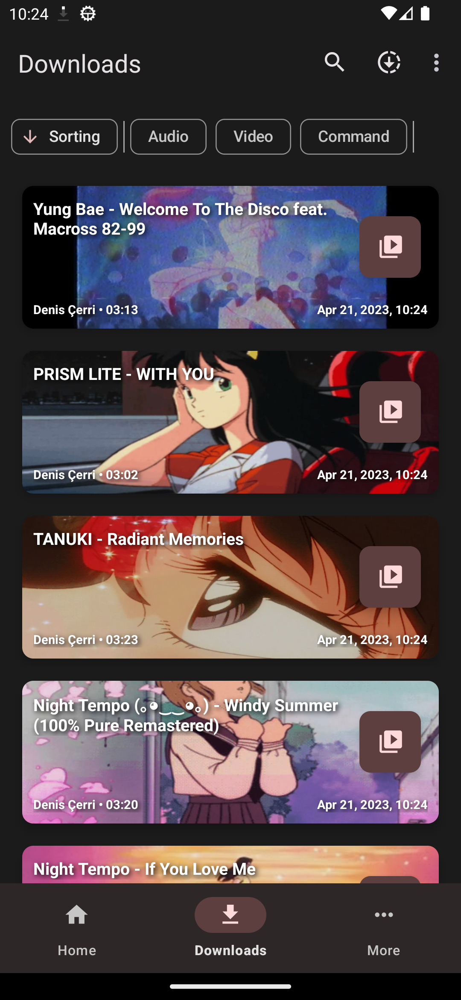
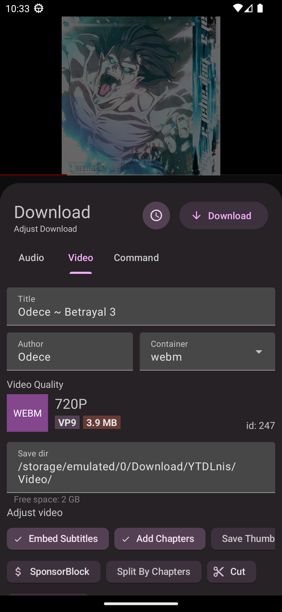
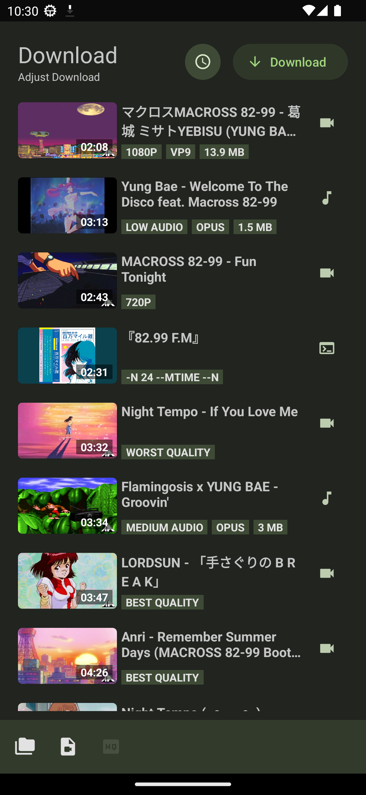
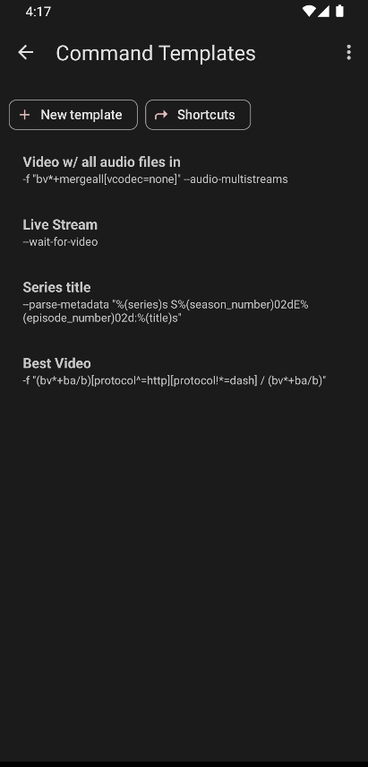
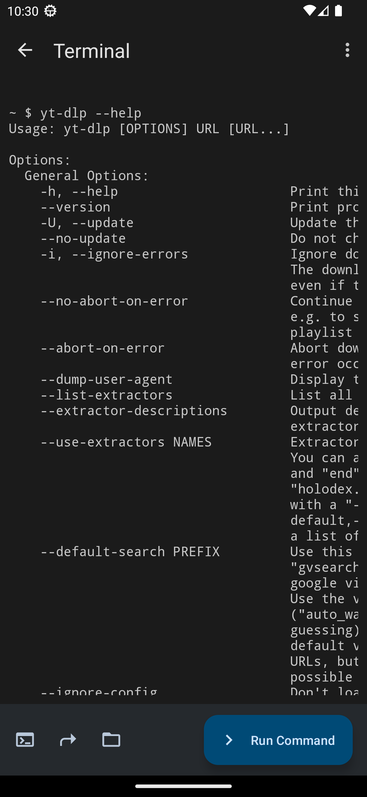
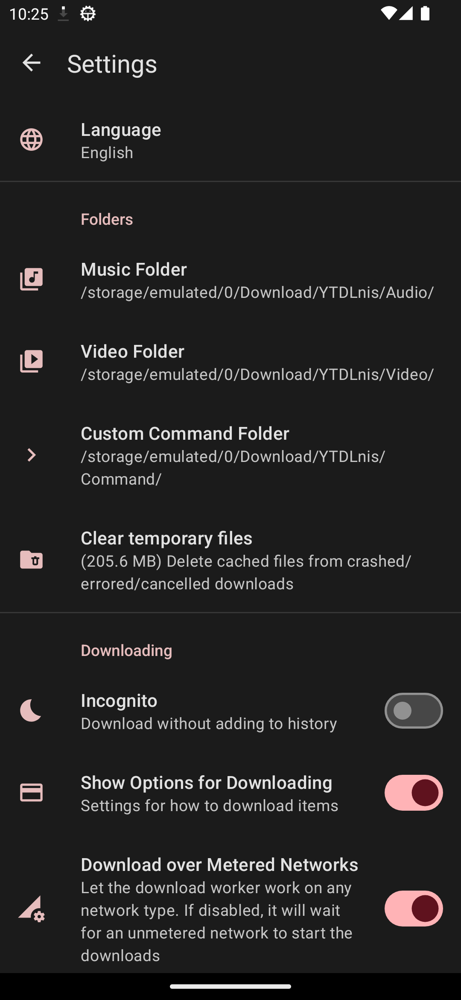
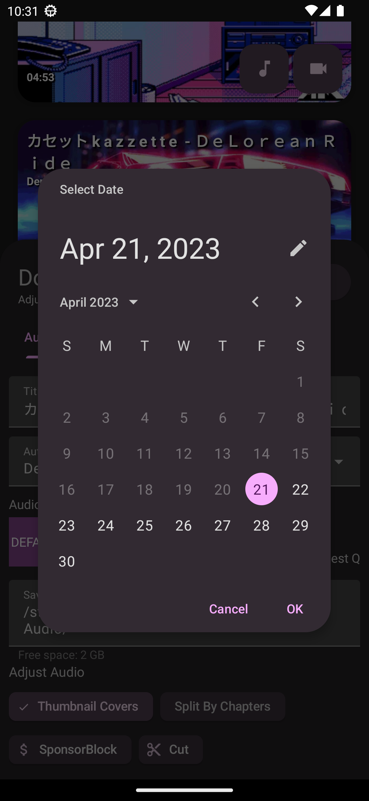
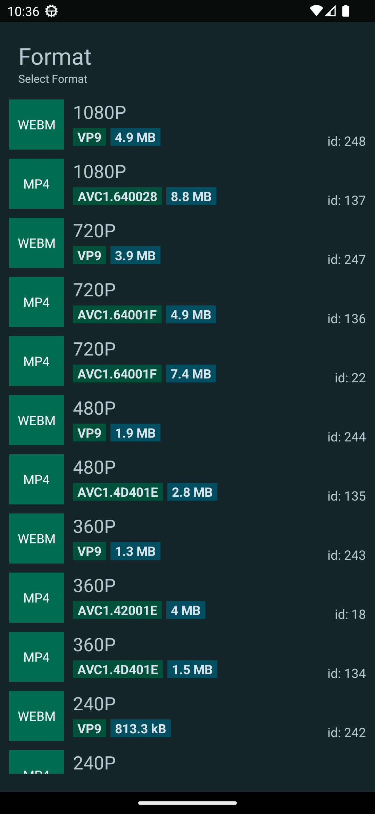
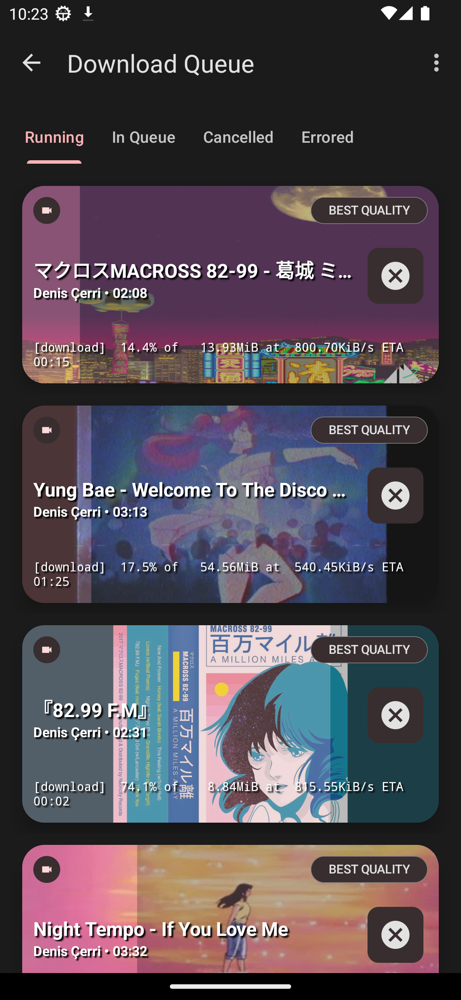
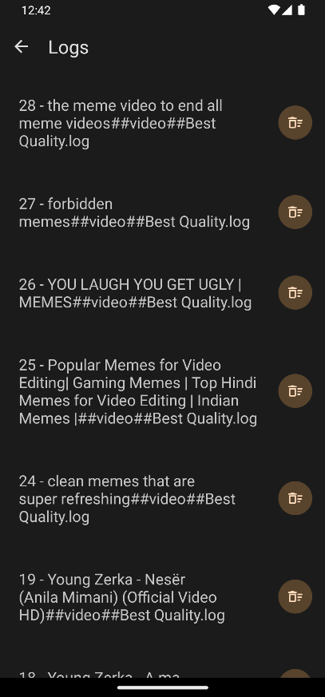
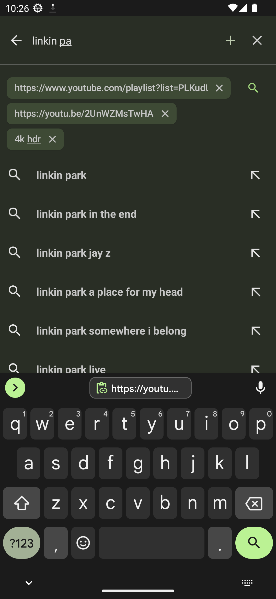
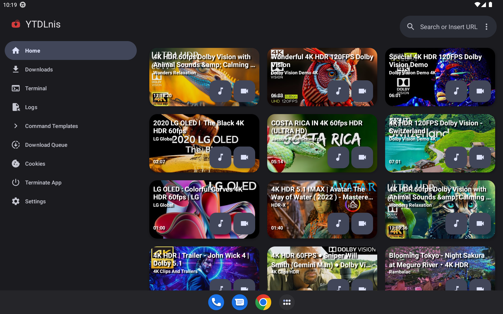

## 💬 Kontak

Bergabunglah dengan [Kanal Telegram](https://downloader.setotower.com) atau [Discord](https://discord.gg/WW3KYWxAPm) kami untuk berdiskusi, pengumuman, dan rilis!

## 🔑 Hubungkan dengan ReVanced

Nama paket Aplikasinya adalah "com.setotower.downloader"

## 📝 Bantu Menerjemahkan di Weblate

## 😇 Berkontribusi

Jika kamu ingin berkontribusi. Silakan baca bagian [Berkontribusi](../CONTRIBUTING.MD).

## 📄 Lisensi

[GNU GPL v3.0](https://github.com/aezammi/setotower-downloader-android/blob/main/LICENSE)

⚠️  Peringatan  

Pengecualian untuk kode sumber yang dilisensikan di bawah lisensi GPLv3, semua pihak lain dilarang menggunakan nama 'Setotower Downloader' sebagai aplikasi pengunduh, begitu pula dengan turunannya (derivatif). Turunannya (derivatif) termasuk, tetapi tidak terbatas pada percabangan (fork) dan build tidak resmi.

## 🙏 Ucapan Terima Kasih

- [yt-dlp](https://github.com/yt-dlp/yt-dlp) dan kontributornya karena memungkinkan alat ini ada. Tanpanya, aplikasi ini tidak akan demikian.
- [youtubedl-android](https://github.com/yausername/youtubedl-android) karena mem-porting yt-dlp ke Android
- [dvd](https://github.com/yausername/dvd) karena memperlihatkan bagaimana caranya mengimplementasikan youtubedl-android
- [decipher3114](https://github.com/decipher3114) atas ikon aplikasinya

dan banyak lagi orang asing lainnya yang ada di forum internet.
